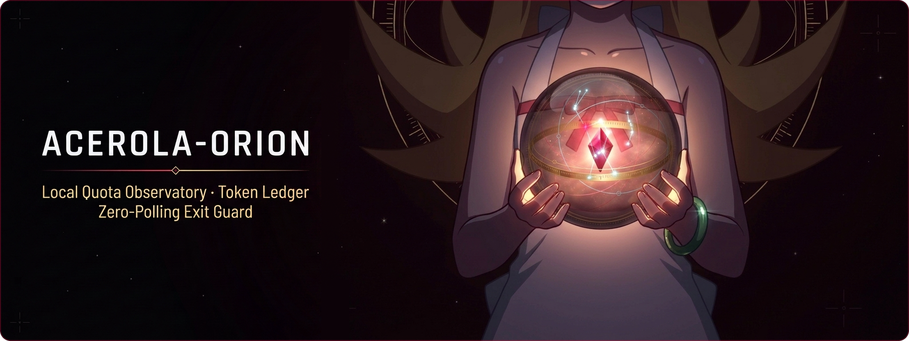

<p align="center">
  
</p>

<h1 align="center">Acerola-Orion (雅赛劳拉莉昂)</h1>

<p align="center">
  <strong>面向 Google Antigravity 的 7 位高精度配额水位看板、被动式 Prompt KV 缓存余温与 200K 双倍计价预警雷达、本地隐私隔离 Token 账本（Orion）、只增不删对话防误删时光保险箱（Orion-Vault）与事件驱动 Win32 内核孤儿进程退出守卫（Acerola）。</strong>
</p>

<p align="center">
  <a href="https://github.com/zanex-dev/acerola-orion/actions/workflows/ci.yml"></a>
  <a href="pyproject.toml"></a>
  <a href="LICENSE"></a>
  <a href="pyproject.toml"></a>
  
</p>

<p align="center">
  <a href="README.md"><strong>English</strong></a> · <a href="README_ZH.md"><strong>简体中文</strong></a> · <a href="AGENTS.md">架构与模块导览</a> · <a href="docs/PLUGIN_ARCHITECTURE.md">插件架构指南</a> · <a href="CHANGELOG_ZH.md">更新日志</a>
</p>

---

## 🔒 零信任安全自证（3 秒源码验毒）

针对社区近期对第三方工具窃取登录态或诱导异常授权的担忧，本项目在架构层执行最严苛的本地物理边界，欢迎任何人直接审计明文源码：

1. **零第三方依赖（`dependencies = []`）**：100% 构建于 Python 3.10+ 标准库与原生 Win32 `ctypes`，拒绝引入任何第三方 `pip` 供应链黑盒包。
2. **零外网连接（硬编码锁死 `127.0.0.1`）**：全仓唯一的 `HTTPConnection` 在构造函数层硬性断言 `host == "127.0.0.1"`，仅向本机运行中的官方客户端回环端口发起只读状态查询，**绝不向谷歌或任何外部服务器发送 1 字节网络包**。
3. **零凭证与严格本地隐私边界**：
   - **绝不**请求任何 OAuth 授权，**绝不**读取 `state.vscdb`、Windows DPAPI 凭据库、浏览器 Cookie 或任何 Token；读取本机代理环境变量时经 `urllib.parse.urlsplit` 剥离认证信息（`userinfo`、查询参数与片段），仅保留 `scheme://host[:port]`；
   - **Orion-Ledger** 本地账本仅只读统计 `transcript.jsonl` 中的 Token 计数字段与经清洗的会话标题（无注释标题时自动回退至 `conv_id[:8]`，**绝不在账本库存储对话正文**）；
   - **Orion-Vault**（纯本地、支持随时开关）仅在 `~/.gemini/acerola_orion/chat_vault` 下增量备份文本日志、对话 SQLite 库与纯文本/SVG Artifacts，物理跳过 `.user_uploaded`、`browser_sandbox`、`tempmediaStorage`、`.allow_media` 及全部位图/音视频文件，阻断符号链接与 NTFS 重解析点越界；终端与 JSON 输出自动脱敏，不回显个人登录邮箱。
4. **纯明文源码发布声明（谨防李鬼套壳）**：官方**仅以纯明文 Python 源码形式发布**，绝不提供任何闭源编译打包的单文件 `.exe` 安装程序；请勿运行来历不明的第三方编译包。
5. **一键源码自查命令（PowerShell 3 秒验真）**：

```powershell
# 一键检索全仓所有网络、凭据与外部进程调用，结果一目了然：
Get-ChildItem .\acerola_orion -Recurse -Filter *.py | Select-String -Pattern "HTTPConnection|socket|subprocess|vscdb|Cookie|oauth"
```

---

## 核心能力矩阵

### 🔭 1. Orion · 高精度配额透视、200K 双倍预警与本地 Token 账本
1. **7 位浮点精度双通道配额看板 (`Orion-Telemetry`)**
   - 原生 Win32 `CreateToolhelp32Snapshot` 进程树识别 + 本机 `127.0.0.1` 只读 Connect-RPC 查询（`GetUserStatus`、`GetLoadCodeAssist`、`RetrieveUserQuotaSummary`）；
   - 绕过前端 UI 模糊进度条，精确直读 `gemini-5h`、`gemini-weekly`、`3p-5h`、`3p-weekly` 剩余百分比，并精准区分 `100.000%` 满额待命未触发计时与真实重置倒计时；
   - 采用 Win32 `FILE_SHARE_READ | FILE_SHARE_WRITE | FILE_SHARE_DELETE` 无锁增量游标解析本地日志，分离统计主对话 `HTTP 429/503` 限流与旁路杂项 `429`（自动起标题/搜索摘要等），记录旁路风控模型（`sir_flash_lite` / `severe_internal_risks_agy`）附加延迟耗时，并对代理环境变量执行 `urlsplit` 凭证脱敏。
2. **纯本地被动「Prompt KV 缓存 250s 余温雷达」与 200K 双倍计价预警 (`Orion-CacheRadar`)**
   - **零额外发包、零端口介入**：仅在目标 `transcript.jsonl` 的 `(mtime_ns, size)` 变化时增量无锁读取末尾 `16KB`（移除缺失文件负缓存，晚创建日志无需重启即刻发现），计算活跃上下文体积、缓存命中率与 **4分10秒（250s）缓存余温倒计时**；
   - **200K 2x 双倍计价阶梯预警与一键复制 `/compact`**：当上下文进入 `180K–200K`（临近双倍）或达到 `≥200K`（触发 2x 计价）时，在星盘雷达栏、桌面悬浮胶囊与系统托盘同步预警，并提供一键复制 `/compact` 指令压缩上下文；支持 **智能守大窗 (`smart_guard`)**、**纯跟最新 (`latest`)** 与 **手动锁窗 (`pinned`)** 策略。
3. **本地隐私隔离 Token 明细账本 & 预设倍率估算 (`Orion-Ledger`)**
   - 按**日期、模型家族（4C / 4N · Gemini 4 Neon / 4A / 4H / Flash / Claude / GPT-OSS）、单次会话**精确统计 `Input`、`Cache-Read`（兼容 `cache_read_input_tokens`）、`Output` Token，辅以跨进程文件锁、SHA-256 增量前缀校验、坏游标回退重建与无注释标题回退 `conv_id[:8]` 防正文泄漏；
   - 并列对比 **1.0x 官方 API 基准价**、**0.5x 促销折算价** 与 **1.5x 本地预设倍率估算**（明确标注为用户可见本地预设估算，非服务端账单），并结合本机已匹配对话步骤与 7 位精度配额水位差（含独立 `p3_5h_drop_pct` 通道与偶数样本中位数）追踪未匹配步骤配额变化。

### 🗄️ 2. Orion-Vault · 只增不删对话自动增量备份与防误删时光保险箱
- **只增不删（Append-Only）防误删保护**：通过 SQLite Online Backup + gzip 增量热备 `conversations/<uuid>.db`，同步留存 `conversation_summaries.db` 汇总记录（含 `raw_summary`）、`annotations/<uuid>.pbtxt` 与 `brain/<uuid>/` 下的纯文本/SVG Artifacts；
- **拦截主库删除、支持一键恢复与导出**：当你在 Antigravity 客户端点击删除对话后，保险箱绝不跟随删除，而是自动将其标记为 `deleted`（已删可恢复），随时通过 CLI 或主控台第 4 页签「🗄️ 对话防删保险箱」一键原位恢复（`vault restore`）或导出可读 Markdown（`vault export`）；
- **可控开关与严格媒体隔离**：提供 `vault_auto_backup` 独立总开关（支持 `vault on/off/toggle`、主控台开关按钮与托盘右键菜单），关闭后立即短路零写入且保留历史备份；全程物理跳过媒体目录/位图/音视频文件并拦截软链接/重解析点。

### ⚔️ 3. Acerola · 事件驱动 Win32 内核句柄孤儿进程断头台
- **三大核心防坑价值（关窗即断，拒绝后台残留）**：
  1. **防止后台自动压缩上下文**：官方客户端关闭主窗口后，残留的 `language_server*.exe` 孤儿进程可能继续在后台静默触发上下文自动压缩（Auto-Compaction），裁切你原本保留的长会话上下文；
  2. **防止污染本地工程记忆**：阻止孤儿进程在关窗收工后静默执行后台记忆蒸馏（Knowledge / Memory Distillation），避免未完结的调试状态写入工程记忆库；
  3. **防止继承主力模型偷跑额度**：避免孤儿进程继承关窗前挂载的高成本主力模型（如 `Gemini 4 Carbon / Neon / Argon` 或 `Claude Opus`）在后台持续消耗配额。
- **事件驱动内核唤醒 & 归属句柄严格验真**：直接对真实 Electron UI 根主进程持有 Win32 `SYNCHRONIZE` 内核句柄并阻塞于 `WaitForMultipleObjects`（无轮询空转），最小化或缩入托盘绝不误杀；主程序真正退出时由内核即时唤醒，并仅清理已验明**同用户 SID（`advapi32` fail-closed）、同安装目录、同 UI 祖先且持有自身 hub** 的受控 `language_server*.exe` 句柄与陈旧 `hub_*.json`；同时在后台承载受 `vault_auto_backup` 控制的 Orion-Vault 增量巡检线程。

### 🧩 4. 官方内置白帽可选插件（默认开启，可按需自选关闭）
- **纯标准库微内核（0 第三方依赖）+ 3 大可选白帽扩展**：底座默认零外部依赖，通过标准 `entry_points` 挂载 3 个官方白帽插件（架构与插槽契约详见 [docs/PLUGIN_ARCHITECTURE.md](./docs/PLUGIN_ARCHITECTURE.md)）：
  1. **`version_vault`（不可删工作区版本冷库 + `acerola-orion archive` CLI）**：扫描工作区历史版本草稿并经双向校验外迁至 `~/.gemini/acerola_orion/version_vault/` 不可删外部冷库，配套完整 `archive` 子命令与主控台冷库页签，避免迭代覆盖或误删旧版；
  2. **`tasks_board`（只读 `.agents/tasks/` 任务拆解与交接单看板）**：在桌面主控台提供只读任务包与阶段交接单可视化看板，一览原子卡片进度与依赖状态；
  3. **`eoq_guard`（200K 上下文水位提示与单窗免限切换）**：结合 200K 上下文边界提供 EOQ 水位收口提醒，并支持按需对单个会话窗口切换免限状态。
- **灵活自选开关（零入侵按需退回裸核）**：无需改代码即可通过环境变量逐个关闭任意插件（`ACEROLA_ORION_DISABLED_PLUGINS=eoq_guard`，支持逗号分隔多选），或设置 `ACEROLA_ORION_DISABLE_PLUGINS=1` 一键运行在 0 插件纯净裸核模式。

### 🛠️ 5. 随仓官方配套 Antigravity Skills & Hooks 套件（可选一键可逆装配）
- **100% 明文可审计白帽套件（`acerola_orion/integrations/antigravity/`，共 18 个纯明文资产）**：随仓内置与星盘、任务看板、版本冷库协同工作的官方伴侣资产，涵盖 `acerola-orion` 全局插件（`acerola-orion` / `orion-vault` 技能）、全局效率技能（`session-recall` 跨会话切片检索、`kv-keepalive` 短时缓存续温）、工作区插件（`eoq-task-relay` 的 `task-decomposer` / `stage-handoff`、`engineering-core` 的 `version-seal` 与可选工程准则 `rules/AGENTS.md`）以及内置 `eoq_hook` / `vault` Hooks 模板。
- **非破坏性按需安装与干净卸载（`acerola-orion companion`）**：默认绝不静默改写 `~/.gemini/config/`；用户可随时通过 `companion status / install / uninstall` 查看状态、合并注册 Orion 托管项（支持 `--workspace <path>`、`--include-rules`、`--no-hooks`、`--no-global-skills`、`--force`），或一键精准卸载托管项且完整保留用户自有配置。

---

## ⚔️ 断头台守卫（Acerola Guard）使用与后台常驻说明

> 💡 **核心机制：开启一次，无感驻留（与 GUI 仪表盘完全独立！）**
> - **只需开启一次**：无论通过桌面主控台点击 **`🛡️ 自启守卫`**，还是在终端执行一次 `acerola-orion guard install`，断头台就会作为独立的无界面事件驱动内核等待进程常驻后台（同时在 `vault_auto_backup` 开启时执行 Orion-Vault 后台增量备份）。
> - **开机静默自启，绝不弹仪表盘**：注册自启后，每次电脑开机登录时**仅在后台静默拉起断头台守卫进程，绝不会弹黑框，也绝不会自动唤起 GUI 仪表盘打扰你**。
> - **彻底关掉仪表盘也照常生效**：桌面仪表盘（`panel`）仅用于你想看星盘水位、查账单或浏览保险箱时按需打开；哪怕你点击“彻底退出”关掉仪表盘，后台断头台依然全天候值守，每次关掉 Antigravity 主窗口都会自动清理受控残留孤儿进程。

| 使用场景 | 图形界面操作 (`acerola-orion panel`) | 命令行操作 (PowerShell / CMD) |
| :--- | :--- | :--- |
| **一键开启并开机静默自启（推荐）** | 点击守卫卡片 **`🛡️ 自启守卫`**（或托盘右键启用） | `acerola-orion guard install` |
| **查看断头台当前是否在后台运行** | 查看守卫卡片是否显示 `🟢 进程守卫运行中` | `acerola-orion guard status` |
| **仅本次临时启动 / 停止（不写自启）** | — | `acerola-orion guard start` / `stop` |
| **彻底停用并干净移除开机自启** | 点击守卫卡片 **`⏹️ 停用`**（或托盘右键停用） | `acerola-orion guard uninstall` |
| **查看历史斩杀记录日志** | 切换至 **「🩺 旁路风控示波与守护日志」** 页签 | 查看 `~/.gemini/acerola_orion/guillotine.log` |

---

## 快速使用

### 1. 按需运行（无需安装后台自启）

```powershell
git clone https://github.com/zanex-dev/acerola-orion.git
cd acerola-orion
pip install -e . --no-deps

# 实时 7 位精度配额水位、订阅层级、旁路延迟体检与保险箱摘要
acerola-orion status

# 纯本地观测当前活跃会话上下文体积、200K 2x 计价预警与 Prompt KV 缓存 250s 余温倒计时
acerola-orion radar

# 近 14 天每日 Token 明细账单、Gemini 4 Neon 等模型分类与本地预设倍率估算
acerola-orion ledger --days 14

# 单独执行配额水位采样与未匹配步骤配额变化分析
acerola-orion audit

# Orion-Vault 对话防误删时光保险箱（只增不删、随时可开关）
acerola-orion vault status
acerola-orion vault sync
acerola-orion vault on            # 开启自动备份（支持 off / toggle）
acerola-orion vault list --deleted
acerola-orion vault search "关键词"
acerola-orion vault restore <uuid前缀>
acerola-orion vault export <uuid前缀>

# 官方白帽可选插件：工作区不可删版本冷库 CLI（version_vault）
acerola-orion archive status --json
acerola-orion archive scan
acerola-orion archive seal --confirm

# 可选：一键检查 / 可逆装配随仓官方配套 Antigravity Skills & Hooks 套件
python -m acerola_orion companion status
python -m acerola_orion companion install --workspace .                 # 附加 --include-rules 可选装全局规则模板，--force 刷新托管副本
python -m acerola_orion companion uninstall --workspace . --remove-workspace --remove-global

# 按需关闭单个插件或进入 0 插件纯净裸核模式
$env:ACEROLA_ORION_DISABLED_PLUGINS="eoq_guard"; acerola-orion panel
$env:ACEROLA_ORION_DISABLE_PLUGINS="1"; acerola-orion status

# 启动猎户座星盘桌面主控台（支持 DWM 沉浸暗黑窗框、多页签含保险箱与官方插件、点 × 缩入托盘暂停刷新定时器）
acerola-orion panel

# 一键以「极简专注模式」启动（同屏仅聚焦 1 个核心指标 + 1 张趋势统计图，亦可在界面右上角随时切换）
acerola-orion panel --zen

# 可选：一键注册 Windows 开始菜单与任务栏独立图标快捷方式（附加 --remove 可移除）
acerola-orion shortcut
```

### 2. 可选：开机自启孤儿进程守卫（完全透明可逆）

```powershell
# 启用并注册当前用户登录自启守卫
acerola-orion guard install

# 一键彻底停止守卫并移除计划任务与启动脚本
acerola-orion guard uninstall
```

> **系统驻留透明度说明**：执行 `guard install` 仅在用户目录 `~/.gemini/acerola_orion/start_guard_silent.vbs` 生成 3 行明文 VBScript（用于在登录时不弹黑框拉起 `pythonw.exe -m acerola_orion guard daemon`），并注册当前用户级计划任务 `AcerolaOrionGuard`（无需管理员提权、不修改注册表或客户端 `app.asar`）。执行 `guard uninstall` 即可一键彻底清除。

### 3. 运行安全自审与单元测试套件（`85/85` 项）

```powershell
python -m unittest discover -s tests -v
```

---

## ⚠️ 非官方声明与免责边界 (Disclaimer)

1. 本项目为独立开发的纯本地成本记账、配额观测与退出后孤儿进程回收工具，**与 Google 无任何隶属、赞助或官方关联**。
2. 本工具全程仅读取本地文本日志与本机 `127.0.0.1` 回环状态接口，**不修改客户端安装包（`app.asar`）、不破坏数字签名、不提取任何账号凭证、不代理或篡改任何云端请求**。
3. 本软件按 PolyForm Noncommercial License 1.0.0“原样（AS IS）”提供，仅供个人学习与本地可观测性研究，使用者自担风险。若使用者同时或过往使用过第三方 OAuth 登录态提取器、`2API` 逆向反代池、篡改版客户端或非正规共享/转售账号，由此引发的一切账号风控或限制均与本纯本地工具无关。

## 开源许可

本项目基于 [PolyForm Noncommercial License 1.0.0](LICENSE)（`PolyForm-Noncommercial-1.0.0`）发布 —— **个人学习、自用与非营利研究免费开放；严禁将本项目代码或 `assets/` 视觉头图及美术素材用于任何商业用途、付费服务、打包倒卖或二次售卖**，商业授权请联系作者 zanex-dev。

`Required Notice: Copyright (c) 2026 zanex (zanex-dev) (https://github.com/zanex-dev/acerola-orion)`
